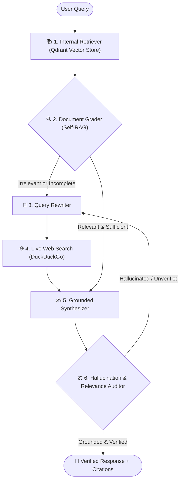

# 🔍 DeepResearch-CRAG: Autonomous Deep Research & Corrective-RAG Engine

[](https://www.python.org/downloads/release/python-3120/)
[](https://github.com/langchain-ai/langgraph)
[](https://qdrant.tech/)
[](https://ai.google.dev/)
[](https://opensource.org/licenses/MIT)

An enterprise-grade, stateful **Corrective-RAG (CRAG)** and **Self-RAG** autonomous research agent engineered with **LangGraph**, **Qdrant Vector Database**, and **Google Gemini Flash**. 

Unlike naive RAG systems that blindly feed retrieved context into LLMs, **DeepResearch-CRAG** implements deterministic quality control loops: it audits internal documents for relevance, autonomously rewrites queries to search the live web when internal coverage is insufficient, fact-checks its own outputs for hallucinations, and produces structured research reports with verified footnote citations.

---

## 🏗️ Architecture Flow



---

## 🌟 Key Engineering Features

- **🛡️ Self-RAG Quality Control**: Evaluates internal vector chunks using Pydantic structured output (`yes` / `no` binary scoring) to discard irrelevant context before it reaches the generation stage.
- **🔄 Query Rewriting & Live Web Fallback**: When internal enterprise documents lack sufficient coverage, an LLM query rewriter strips conversational filler and searches the live web via DuckDuckGo.
- **⚖️ Dual-Vector Hallucination Grading**: Before an answer is presented to the user, an evaluator node checks:
  1. **Faithfulness**: Is every fact strictly grounded in the retrieved documents?
  2. **Relevance**: Does the answer directly answer the user's specific query?
- **📑 Verifiable Footnote Citations**: Generates inline citations (`[1]`, `[2]`) mapped to a structured audit list containing the source URL/document and verbatim supporting quotes.
- **⚡ Anti-Infinite Loop Circuit Breaker**: State-level iteration counters prevent runaway agent execution and excessive API consumption.

---

## 📁 Project Structure

```text
deep-research-crag/
├── .env.example             # Template for API keys
├── .gitignore               # Comprehensive Git ignore
├── .python-version          # Python 3.12 pin
├── pyproject.toml           # Project dependencies & build config
├── README.md                # Documentation & Architecture
└── deep_research/
    ├── __init__.py          # Package exports
    ├── state.py             # LangGraph state schema (TypedDict + Reducers)
    ├── knowledge_base.py    # Enterprise reference policy corpus
    ├── retriever.py         # Local in-memory Qdrant vector retrieval
    ├── grader.py            # Self-RAG Document relevance grader
    ├── tools.py             # Query rewriter & DuckDuckGo search tool
    ├── generator.py         # Grounded synthesizer with citation mapping
    ├── evaluator.py         # Hallucination & answer relevance auditor
    └── graph.py             # LangGraph StateGraph assembly (Step 7)
```

---

## 🚀 Quickstart & Setup

### 1. Prerequisites
- **Python 3.12**
- **Google Gemini API Key** (Free tier available at [Google AI Studio](https://aistudio.google.com/))

### 2. Installation

Clone the repository and create your virtual environment:

```bash
git clone https://github.com/YOUR_USERNAME/deep-research-crag.git
cd deep-research-crag

# Create virtual environment using uv or python
uv venv --python 3.12
# Activate environment
.venv\Scripts\activate   # Windows
# source .venv/bin/activate # Linux/Mac

# Install dependencies
uv pip install -e .
```

### 3. Environment Configuration

Copy the `.env.example` file to `.env`:

```bash
cp .env.example .env
```

Add your Gemini API key:
```env
GOOGLE_API_KEY=your_gemini_api_key_here
```

---

## 🧪 Testing Individual Modules

Each module in `deep_research/` is designed to be tested independently in isolation:

```powershell
# 1. Test Document Grader (Noise rejection)
.venv\Scripts\python -m deep_research.grader

# 2. Test Internal Vector Retriever
.venv\Scripts\python -m deep_research.retriever

# 3. Test Query Rewriter & Live Web Search
.venv\Scripts\python -m deep_research.tools

# 4. Test Grounded Synthesizer with Citations
.venv\Scripts\python -m deep_research.generator

# 5. Test Hallucination & Fact-Checking Auditor
.venv\Scripts\python -m deep_research.evaluator
```

---

## 📄 License
This project is licensed under the MIT License - see the LICENSE file for details.
